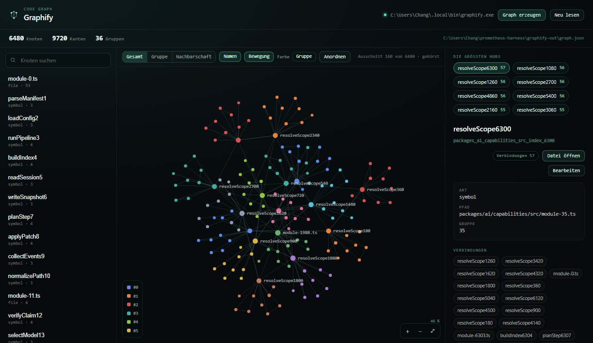
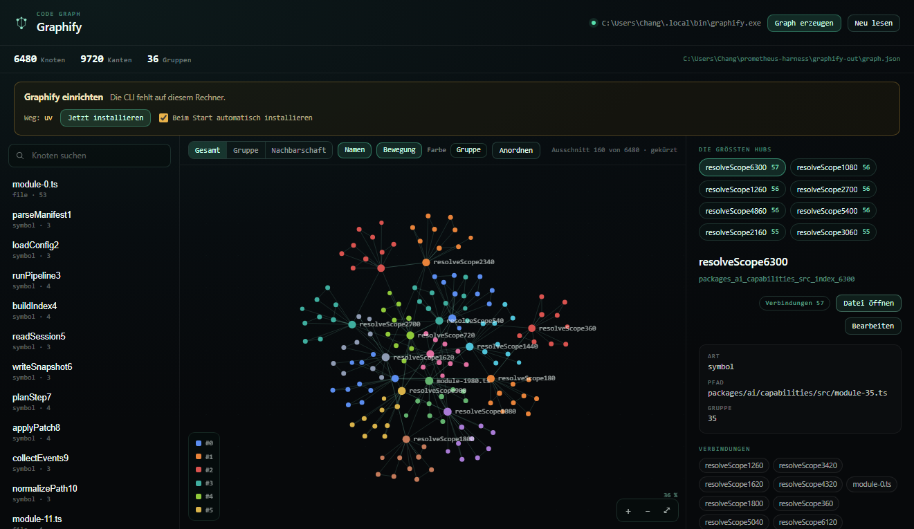

# dsh-plugin-graphify

**Graphify als Plugin für den DeepSeek Harness.** Ein Sidebar-Eintrag, ein
gezeichneter Code-Graph in drei Ebenen, Knotensuche, Hubs, Code-Viewer — und
eine CLI, die sich beim ersten Start selbst installiert, wenn sie fehlt.



*Vorschau mit Beispieldaten (hostfreie Prüfseite), nicht der Graph eines echten
Repositories.*

## Was es zeigt

- **Drei Ebenen**, umschaltbar in der Werkzeugleiste:
  - **Gesamt** — eine Stichprobe über die 16 größten Gruppen; je Gruppe wächst
    die Auswahl vom wichtigsten Knoten aus, damit farbige Inseln entstehen
  - **Gruppe** — alle Knoten einer Gruppe
  - **Nachbarschaft** — die Umgebung eines Knotens, Tiefe 1–3
- **Canvas-Graph** mit Kräfte-Layout: Mausrad zoomt um den Zeiger, Ziehen
  verschiebt Knoten und Fläche, `⤢` paßt ein, „Anordnen" startet neu
- **Suche** über Name, Art und Pfad; **größte Hubs** als Schnellauswahl
- **Knotendaten**: Art, Pfad, Gruppe, Verbindungen; Nachbarn sind anklickbar
- **Code-Viewer** mit Zeilennummern und Syntaxfarben; **Bearbeiten** mit
  `Strg+S`, Rückfrage bei ungespeicherten Änderungen
- **Graph erzeugen** startet `graphify extract` über die Host-Route
- **Selbstinstallation**: fehlt die CLI, wird sie über `uv`, `pipx` oder `pip`
  nachgezogen — siehe unten

## Installation

Voraussetzungen: ein DeepSeek Harness mit Web-Oberfläche und Bun. Für die
Selbstinstallation der CLI zusätzlich `uv`, `pipx` oder Python (optional).

```powershell
git clone https://github.com/LangLi7/dsh-plugin-graphify.git
cd dsh-plugin-graphify
bun run build      # optional — lib/ ist mitgeliefert
```

Dann im **Plugin-Manager** den Ordner `dsh-plugin-graphify` installieren
(Eintrag `pmh-graphify`) und den Host einmal neu starten. Das Paket ist
**Bündel und Plugin zugleich**: `dsh.bundle.patch` meldet die Host-Hälfte an,
`dsh.client` die Browser-Hälfte. Es hat keine Workspace-Abhängigkeiten; die
Host-Hälfte ist gebündelt, die Browser-Hälfte kommt als fertiges Modul.

Nach dem Neustart steht **Graphify** in der Seitenleiste. Fehlt der Graph noch,
führt der Knopf **Graph erzeugen** den ersten Lauf aus.

## Graphify kommt mit

Beim Start prüft das Plugin, ob die CLI erreichbar ist — unter `command`, in
`PATH` und an den bekannten `uv`-Orten. Fehlt sie und steht `setup` auf `auto`
(Vorgabe), installiert der Provider sie **einmal** im Hintergrund:

| Reihenfolge | erkannt an | Befehl |
|---|---|---|
| 1 | `uv` | `uv tool install graphifyy` |
| 2 | `pipx` | `pipx install graphifyy` |
| 3 | `python`/`python3`/`py` | `python -m pip install --user graphifyy` |

Nach Erfolg wird der gefundene Pfad als `command` gespeichert. Fehlt jeder
Paketmanager, passiert nichts Automatisches; das Panel zeigt die Hinweise für
das jeweilige System.



Im Panel steht bei fehlender CLI ein Kasten mit Weg, **Jetzt installieren**,
Ausgabe und dem Schalter „Beim Start automatisch installieren". Abschalten:

```json
// $DSH_HOME/world/graphify.json
{ "command": "graphify", "outDir": "graphify-out", "root": ".", "setup": "never" }
```

`setup` kennt `auto`, `ask` und `never`. Installiert wird nur das PyPI-Paket
`graphifyy`; kein `sudo`, kein `curl | sh`, kein Installer-Download, Abbruch
nach fünf Minuten.

Der **MCP-Server** bleibt ein eigener Profil-Eintrag — er ist maschinenspezifisch
und gehört nicht in ein Plugin:

```yaml
- insert:
    - id: graphify-mcp
      name: '@deepseek-ai/dsh-mcp-client'
      config:
        serverName: graphify
        transport: stdio
        command: 'C:\Users\Chang\.local\bin\graphify-mcp.exe'
        args: ['--graph', 'C:\Users\Chang\prometheus-harness\graphify-out\graph.json']
        env: {}
        cwd: 'C:\Users\Chang\prometheus-harness'
```

## Einstellungen

Plugin-Einstellungen → Graphify:

| Feld | Werte | Vorgabe | Wirkung |
|---|---|---|---|
| `surface` | `sidebar` · `plugins` · `both` · `none` | `sidebar` | wo das Plugin erscheint |
| `order` | Zahl | `12` | Platz in der Leiste bzw. Liste |
| `label` | Text | leer | eigene Beschriftung |
| `view` | `split` · `graph` · `list` | `split` | welche Flächen aufgehen |
| `level` | `gesamt` · `gruppe` · `nachbarschaft` | `gesamt` | Ebene beim Öffnen |
| `depth` | `1`–`3` | `2` | Schritte der Nachbarschaft |
| `limit` | `20`–`400` | `160` | Höchstzahl gezeichneter Knoten |
| `labels` | `true`/`false` | `true` | Namen an den Knoten |
| `colour` | `community` · `kind` | `community` | Farbe nach Gruppe oder Art |
| `motion` | `true`/`false` | `true` | Layout beim Anfassen weiterrechnen |
| `inspector` | `right` · `below` · `off` | `right` | wohin die Knotendaten kommen |

## Routen

Alle Routen liegen unter `/api/world/graphify` und antworten **nur** auf
Loopback-Anfragen.

| Weg | Methode | Antwort |
|---|---|---|
| `/status` | GET | CLI, Ordner, Knoten/Kanten |
| `/graph` | GET | der Graph als Welt-Form |
| `/run` | POST | Lauf `{ mode: "deep" \| "update" }` |
| `/config` | GET/POST | `{ command, outDir, root, setup }` |
| `/setup` | GET | CLI, uv, pipx, Python, Weg, letzter Versuch |
| `/setup` | POST | Installation `{ method: "uv" \| "pipx" \| "pip" }` |
| `/file?path=…` | GET | `{ path, content, language, lines }` |
| `/file` | POST | `{ path, content }` speichern |

## Aufbau

```
src/host/     Provider: Routen, Konfiguration, Selbstinstallation, Mapping
src/client/   Panel, Canvas, Kräfte-Layout, Texte (de/en)
lib/          gebaute Hälften (index.js, client.js)
build.mjs     baut beide Hälften
```

Die Host-Hälfte ist gebündelt und importiert nur `@deepseek-ai/schemastery`.
Die Browser-Hälfte lädt React von außen und bringt ihre Texte selbst mit; ist
der Namensraum `graphify` schon von einem Sprachpaket belegt, bleiben dessen
Texte zuständig.

## Grenzen

- **Gesamt** ist eine Stichprobe (16 Gruppen, Standard 160 Knoten), nicht der
  ganze Graph: 36 000 Knoten sind kein Bild. Suche und Hubs führen durch den
  Rest.
- **Gruppe** zeigt höchstens `limit` Knoten der Gruppe, nach Grad.
- Das Layout rechnet im Browser; bei 400 Knoten ist es noch flüssig, darüber
  wird gekürzt.
- Die Datei-Route liest den ganzen Graphen je Anfrage (lokal ~0.5 s bei 21 MB).

## Herkunft

Extrahiert aus [`LangLi7/prometheus-harness`](https://github.com/LangLi7/prometheus-harness),
Stand **21.10.2026** (`packages/plugin/graphify` und
`packages/world/graphify`). Dort läuft das Plugin im Verbund mit dem
Sprachpaket; diese Fassung ist eigenständig gebaut.

## Lizenz

Noch keine Lizenz festgelegt. Wer das Repository weiterverwenden will, sollte
vorher eine wählen (etwa MIT); bis dahin gilt das Urheberrecht.
